# EverySolve — Authorized captcha workflows with discovered challenge schemas

<p align="center">
  <picture>
    <source media="(prefers-color-scheme: dark)" srcset="assets/hero-dark.svg">
    <source media="(prefers-color-scheme: light)" srcset="assets/hero-light.svg">
    
  </picture>
</p>

<p align="center">
  <a href="https://cursor.com/en/install-mcp?name=everyinfra&config=eyJ1cmwiOiJodHRwczovL2FwaS5ldmVyeWluZnJhLmNvbS9tY3AiLCJoZWFkZXJzIjp7IkF1dGhvcml6YXRpb24iOiJCZWFyZXIgPEFQSSBLZXk%2BIn19"></a>
  <a href="https://vscode.dev/redirect/mcp/install?name=everyinfra&config=%7B%22type%22%3A%22http%22%2C%22url%22%3A%22https%3A%2F%2Fapi.everyinfra.com%2Fmcp%22%2C%22headers%22%3A%7B%22Authorization%22%3A%22Bearer%20%3CAPI%20Key%3E%22%7D%7D"></a>
  <a href="https://github.com/everyinfra/everyinfra-agent-plugins#claude-code"></a>
  <a href="https://github.com/everyinfra/everyinfra-agent-plugins#codex"></a>
</p>

<p align="center">
  <a href="https://github.com/everyinfra/everyinfra-agent-plugins/stargazers"></a>
  &nbsp;<b>Star the main repo and get $1 in credit.</b> <a href="https://everyinfra.com/en/docs?utm_source=github&utm_medium=readme&utm_campaign=everysolve-plugin&utm_content=star_line#quickstart">How to claim →</a>
</p>

<p align="center"><b>English</b> · <a href="README.zh-CN.md">简体中文</a> · <a href="README.es.md">Español</a></p>

> [!TIP]
> **This repository holds one skill: EverySolve.** The complete EveryInfra plugin (10 skills, the remote MCP server at `https://api.everyinfra.com/mcp`, and setup for Claude Code, Codex, Cursor and VS Code) lives in **[everyinfra/everyinfra-agent-plugins](https://github.com/everyinfra/everyinfra-agent-plugins)**. The buttons above connect the MCP server; the per-host plugin installs are in the main repo.

[Setup](docs/setup.md) · [Workflow](docs/workflow.md) · [Prompts](examples/prompts.md) · [Capability reference](docs/reference.md) · [API documentation](https://api.everyinfra.com/docs)

<sub>Numbers in the image come from the live catalog on 2026-10-24; the live catalog and tool schemas are authoritative.</sub>

EverySolve is a standalone EveryInfra agent skill for authorized captcha integration through MCP. It discovers the supported challenge schema and solution shape, preserves required session context and separates a solver response from acceptance by the target application.

Captcha integrations fail when an application assumes that every challenge produces the same kind of answer. EverySolve first discovers the supported challenge schema and expected solution form, then keeps target authorization and any required browser or session context explicit.

Use this skill only for a target and workflow you are authorized to access or test. It describes how to integrate a supported solution; it is not permission to evade access restrictions or automate abuse.

## What you can do

- Inspect supported challenge types before building an authorized integration.
- Confirm whether the expected result is a token, cookie, text, number or geometric answer.
- Diagnose a session or solution-shape mismatch without blindly retrying paid requests.

## Quick start

This is a standalone, one-skill **MCP workflow** package, not a new API service. It requires a compatible agent host and the configured access described in [setup](docs/setup.md). Local package validation does not establish live API availability.

Install the source repository in Codex after reviewing its contents. These commands add a GitHub-backed repository catalog, not an official marketplace endorsement:

```bash
codex plugin marketplace add everyinfra/everysolve-plugin
codex plugin add everysolve@everysolve-plugin
```

For a local checkout, replace the first command's source with `.`. [Setup](docs/setup.md) also covers Claude Code and the separate service connection.

Configure access once, then ask:

> For this site that I administer, inspect the supported challenge types and list required inputs. Do not solve anything yet.

This initial prompt is scoped to inspection or preparation. Review any paid operation or external side effect before proceeding. Claude Code instructions and Cursor packaging boundaries are in [setup](docs/setup.md).

## How the workflow works

1. Confirm authorization for the exact target and requested operation.
2. Use everyinfra_list_captcha_types to discover type, parameters, availability and solution form.
3. Collect only required challenge inputs; preserve proxy or session identity where the live contract requires it.
4. Call everyinfra_solve_captcha only for the approved target and supported challenge.
5. Interpret the returned solution shape and apply it only within the matching authorized workflow.

### What a useful result contains

A supported solution or an explicit failure state, with the application step matched to its actual shape. A returned token is not proof that the target site accepted it.

## When to use this skill

EverySolve handles an authorized challenge step. It does not supply general browsing, data extraction or permission to access a target. Those prerequisites remain separate.

## Limits and safety

- No guaranteed solution rate or universal support for challenge types.
- No token reuse across unrelated targets or sessions.
- No unsupported-type fallback guesses, unauthorized access or account-abuse workflows.

The package contains one skill and does not grant permissions or register a duplicate MCP connection. Never put credentials in prompts, checked-in files, screenshots or shared logs. Discovery, API execution, billing and a final external result are separate states. See [security](SECURITY.md).

## Frequently asked questions

### Does every challenge return a token?

No. The catalog can describe different solution forms. The caller must inspect the live schema and the actual response.

### Does solving mean the browser flow succeeded?

No. The target may reject an expired or context-mismatched solution. Report solver output separately from target acceptance.

### Can it be used on any site?

Only within a workflow the user is authorized to access or test. This repository does not grant permission or remove a site’s access restrictions.

## Validate and contribute

```bash
python3 scripts/validate.py
```

This offline check validates packaging, local documentation links, the single-skill boundary, metadata and fixtures. It does not send messages, allocate resources or verify a production account. [Contribution guidance](CONTRIBUTING.md) and [the release checklist](RELEASING.md) describe the remaining checks.

Source publication, tagged releases, official marketplace acceptance and live service verification are separate milestones. Maintained by [EveryInfra](https://everyinfra.com). Licensed under [Apache-2.0](LICENSE).
